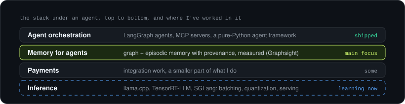

  

  

## Featured work

### [Graphsight](https://github.com/Kcodess2807/graphsight): project memory for coding agents

It turns a repo's GitHub history into a typed graph, then lets an agent add the team facts
GitHub doesn't hold. A tracer shows what the agent retrieved and what it actually used.

- **Memory an agent can correct.** A changed fact ends the old one and keeps it as history.
  A retracted fact stops being recalled.
- **A source on every fact.** The model is told which facts came from GitHub and which an
  agent was told.
- **Measured, with the misses published.** Tasks are written before any run and graded by
  exact match. The eval write-up lists what failed as well as what passed.

`Python` `LadybugDB` `LangGraph` `MCP` `FastAPI` `React`
&nbsp;[Code](https://github.com/Kcodess2807/graphsight) · [PyPI](https://pypi.org/project/graphsight/) · [Site](https://trace-rag.vercel.app/) · [Eval](https://github.com/Kcodess2807/graphsight/tree/main/backend/eval)

### [Saadho](https://saadho.arushk.tech): AI/ML interview prep, day by day

Give it a role, an interview date and your daily hours, and it builds the plan. Live in
production.

- **A plan, in order.** 300+ vetted resources sequenced by prerequisite, with what to skip.
- **Company guides.** How 200+ companies interview, round by round, with sources.
- **A voice practice room.** A group discussion with four AI colleagues in English or
  Hinglish, then a scorecard that quotes your own words.

`Next.js` `Supabase` `LLM agents` `Realtime voice`
&nbsp;[Live site](https://saadho.arushk.tech)

## Reading for open-source contributions: inference

I'm working down the stack, from agents to how a model is actually served. These are the
codebases I'm reading with the aim of contributing.

| Repository | What I'm reading it for |
|---|---|
| [vllm-project/vllm](https://github.com/vllm-project/vllm) | Continuous batching, PagedAttention, and the serving scheduler |
| [ggml-org/llama.cpp](https://github.com/ggml-org/llama.cpp) | Quantization formats (GGUF) and CPU/GPU inference in plain C++ |
| [sgl-project/sglang](https://github.com/sgl-project/sglang) | Prefix caching with RadixAttention and structured-output serving |
| [NVIDIA/TensorRT-LLM](https://github.com/NVIDIA/TensorRT-LLM) | Engine building and GPU-side optimization |
| [ModelTC/LightLLM](https://github.com/ModelTC/LightLLM) | A lightweight Python serving framework: async processes and dynamic batching |
| [skyzh/tiny-llm](https://github.com/skyzh/tiny-llm) | Building an inference engine from scratch, to learn the internals |
| [modular/llm-inference-handbook](https://github.com/modular/llm-inference-handbook) | The reference I read alongside the code |

Notes and experiments:
[inference-engineering0to100](https://github.com/Kcodess2807/inference-engineering0to100).

## More work

| Project | What it is |
|---|---|
| **[SmartFlow](https://smartflow-sigma.vercel.app/)** | A reinforcement-learning traffic-signal controller. Cuts average waiting time about 55% against a fixed-time controller, and extends to a multi-agent 2x2 grid with emergency-vehicle preemption. `SUMO` `PPO/DQN` · [Code](https://github.com/Kcodess2807/SMARTFLOW) |
| **[Bodhi](https://github.com/Kcodess2807/Bodhi)** | A voice-first AI mock interviewer: an adaptive pipeline, RAG over 10K+ chunks, and real-time proctoring. `LangGraph` `pgvector` `YOLOv8` |
| **[PADHO](https://github.com/Kcodess2807/PADHO)** | Agents with hierarchical orchestration and RAG, in pure Python with no framework. |
| **[venvctl](https://github.com/Kcodess2807/venvctl)** | A single-binary Windows CLI that manages Python virtual environments across PowerShell, CMD and Git Bash. `Go` |
| **[ReAct-CLI](https://github.com/Kcodess2807/ReaAct-CLI)** | A small command-line implementation of the ReAct loop: reason, act, observe. |

## Background

- Built ML pipelines processing 10,000+ aerial images a day at Kanchan Drones.
- Built a real-time exam-proctoring system holding sub-200ms latency on GCP.
- Shipped a policy-aware RAG chatbot that answers in under a second.
- Taught an 8-week NLP course to 20+ students.

## Find me

  
  
  
  

